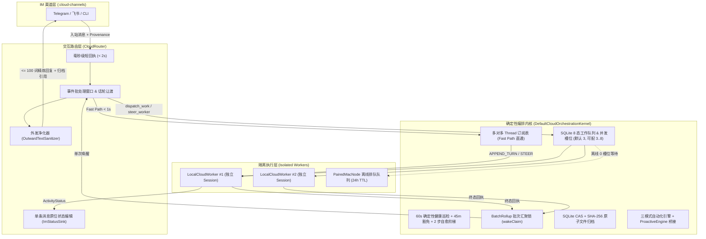

# Amber 云端本体（Cloud Self）P2.5 编排内核架构设计

> 模块路径：`cloud-daemon/src/jvmMain/kotlin/app/amber/cloud/orchestration`
> 核心包名：`app.amber.cloud.orchestration`
> 关联模块：`:cloud-daemon`、`:cloud-channels`、`:cloud-proactive`、`:core:agent`、`:core:session`

---

## 1. 设计背景与定位

Amber 云端本体（Cloud Self，`amberd`）作为 7×24 常驻云端守护进程，需要同时处理来自 Telegram / 飞书等 IM 渠道的实时对话、后台长耗时研发/巡检任务、定时自动化以及未来的配对 Mac 节点（`PairedMacNode`）远程任务。

若采用传统的单 Agent 循环直接挂接长耗时工具，会出现三大工程瓶颈：
1. **单会话阻塞与长对话腐烂（Context Rot）**：长达数十分钟的构建或排查会阻塞用户继续发消息，且海量的工具原始输出会迅速污染主对话上下文。
2. **缺乏崩溃恢复与状态确定性**：纯内存协程一旦遇到进程重启或网络闪断，正在执行的任务便永久丢失，或出现重复派发。
3. **机械感与调试噪音外泄**：把内部工具名、JSON 参数、堆栈错误和长篇推理直接刷进 IM 聊天窗，严重破坏面向人的交互体验。

为此，P2.5 编排内核融合了 **Synara Hub 的确定性状态机/持久化恢复机制** 与 **DeepSeek 超级智能体的 Router/Worker 双层隔离与拟人化交互设计**，在不引入外部重型消息队列的前提下，基于 SQLite WAL 构建了纯 Kotlin 的 Clean-Room 编排内核。

---

## 2. 总体架构与双层拓扑（Router / Worker 分离）

### 2.1 权限矩阵与单层边界（防递归风暴）

| 能力 / 角色 | `CloudRouter`（主对话） | `Worker`（后台执行） | 说明 |
| :--- | :---: | :---: | :--- |
| 直接向 IM 发送/编辑人类消息 | 允许 | 禁止 | Worker 仅通过 `ActivityStatus` 与终态 `WorkerResult` 汇报 |
| 派发新任务（`dispatch_work`） | 允许 | **硬拒绝** | `executeWorkerTool` 强制注入 `ExecutionScope.SUBAGENT` 并拦截 `dispatch_work` / `spawn_subagent` |
| 引导运行中任务（`steer_worker`） | 允许 | 禁止 | 支持在排队或运行中向指定 Worker 追加澄清指令 |
| 执行长耗时工具 / Shell / 检索 | 禁止 | 允许 | Router 仅保留极轻量编排与毫秒级只读诊断工具 |
| 无损只读分页检查 Worker 会话 | 允许 | 禁止 | `read_worker_session` / `read_worker_message_slice` / `diagnose_worker_session` |
| 按 ID 链式召回历史归档对象 | 允许 | 允许（只读） | `recall_object`（Chain of Recall） |

---

## 3. 核心机制详解

### 3.1 身份与来源溯源（`CloudPrincipal` & `SourceMessageProvenance`）

每次任务派发、加塞引导（Steer）与自动化运行均携带强类型身份与消息溯源：
- **`CloudPrincipal`**：
  - `OwnerUser`：主人通过已验证的 IM 账号发起。
  - `ExternalChannelUser`：群聊或外部协作者。
  - `AutomationPrincipal`：定时/事件自动化触发（携带 `automationId` 与 `runId`）。
  - `SystemRecoveryPrincipal`：内核重启恢复或健康巡检自愈触发。
- **`SourceMessageProvenance`**：记录 `channelType`、`chatId`、`senderId`、`messageId`、`replyToMessageId`、`threadKey` 与 `receivedAtMs`，持久化至 `orchestration_work_items` 与 `orchestration_steering_Checkpoints`，确保跨重启后完成通知与原位编辑仍能精确回到源会话。

### 3.2 SQLite 8 态工作队列与三层幂等

工作项（`WorkItem`）在 `orchestration_work_items` 表中经历严格受控的 8 态迁移：
- **活跃态**：`QUEUED`、`DISPATCHING`、`RUNNING`、`WAITING_APPROVAL`、`RECOVERING`
- **终态**：`COMPLETED`、`FAILED`、`CANCELLED`

**三层防重与幂等保障**：
1. **入站消息去重**：基于 `(channelType, chatId, messageId)` 拦截 webhook 重放。
2. **派发计划幂等（`requestId` + `planHash`）**：
   - `OrchestrationHash.planHash(batchRequestId, specs)` 对批次内所有 `WorkItemSpec` 计算规范化 SHA-256。
   - 若相同 `requestId` + 相同 `planHash` 重试，直接返回已持久化的 `DispatchBatchResult`（`deduplicated = true`），绝不重复创建 Worker。
   - 若相同 `requestId` 携带不同 `planHash`，立即抛出 `PlanHashConflictException`。
3. **槽位与离线排队（拍板决定 #2 & #5）**：
   - `OrchestrationConfig.maxConcurrencySlots` 默认为 **`3`**，允许配置范围为 **`3..8`**（超出范围在构造期抛出 `IllegalArgumentException`）。
   - 目标为 `WorkerTarget.PairedMacNode` 且节点当前离线时，任务保持 `QUEUED`、`queuedReason = "OFFLINE_NODE"`，**占用 0 个活跃并发槽位**，最长等待 **24 小时**；节点上线后通过 `setNodeOnline(nodeId, true)` 自动按序派发；超过 24 小时未上线则自动转为 `FAILED` 并通知主人。

### 3.3 多对多 Thread 订阅表与直通快路径（Fast Path）

`orchestration_thread_subscriptions` 表维护外部 IM 会话（`channelType + chatId + threadKey`）与后台 `workId / workerSessionId` 的多对多绑定关系：
- 当某会话中仅绑定了唯一一个活跃 Worker，且用户发来非取消类的简短补充（如“顺便把单元测试也跑一下”），`CloudRouter` 无需等待大模型规划，直接在 **< 1 秒** 内通过 `routeViaSubscriptionFastPath` 命中订阅表并调用 `steerWork` 将指令注入该 Worker。
- 若用户在执行中途直接发送“算了 / 停下 / 别弄了”，Router 立即中断当前生成并级联取消该会话订阅的所有活跃 Worker。

### 3.4 确定性 60 秒健康巡检、45 分钟长工具豁免与两步自愈阶梯

内核拒绝依赖不可靠的纯模型轮询来监管任务，而是由 `tickHealth(nowMs)` 每 **60 秒** 执行确定性状态扫描（拍板决定 #2）：

| 异常场景 | 判定阈值 | 内核动作 |
| :--- | :--- | :--- |
| 已派发未启动 (`DISPATCHING`) | `> 3 分钟` | 判定启动卡死，进入自愈阶梯或标记失败 |
| 审批等待超时 (`WAITING_APPROVAL`) | `> 5 分钟` | 自动取消挂起工具，转入 `FAILED (APPROVAL_TIMEOUT)` 并释放槽位 |
| 断连宽限期 (`disconnectedAtMs`) | `> 90 秒` | 超过 90 秒未重连才触发恢复，避免瞬时网络抖动误杀 |
| 静默无心跳 (`RUNNING` / `RECOVERING`) | `> 10 分钟` | 进入两步自愈阶梯 |
| **长工具白名单豁免** (`activeToolName` 匹配 `xcodebuild`、`gradlew`、`cargo_build`、`docker_build`、`pytest` 等) | 豁免至 **`45 分钟`** | 在 10m～45m 之间虽无流式输出但心跳存活时**不判定为静默卡死**；超过 45 分钟仍未结束才触发恢复 |
| 离线节点排队超时 (`OFFLINE_NODE`) | `> 24 小时` | 转入 `FAILED (OFFLINE_NODE_EXPIRED)` 并向主人汇报 |

**两步自愈阶梯（最多 `2` 次恢复尝试）**：
- **Attempt 1（`recoveryAttempts: 0 -> 1`）**：状态转为 `RECOVERING`，向 Worker 发送轻推恢复指令（Nudge），要求基于现有上下文继续或汇报阻塞点。
- **Attempt 2（`recoveryAttempts: 1 -> 2`）**：再次注入强制收敛恢复提示。
- **超过 2 次仍未恢复**：果断终止任务并置为 `FAILED`，彻底释放并发槽位，触发批次汇总通知。
- **可选模型 Watchdog**：`OrchestrationConfig.enableModelWatchdog` **默认关闭（`false`）**；仅在显式开启且确定性巡检发现疑似死循环时才调用 `WatchdogInspector`。

### 3.5 批次完成汇聚（`BatchRollup`）与单次唤醒锁

当 Router 一次性拆解派发 N 个并行子任务（共享同一个 `batchRequestId`）时：
- 前 N-1 个子任务进入终态时，仅更新 `orchestration_batch_rollups` 进度，**绝不逐个打扰主人**。
- 当第 N 个子任务进入终态（`allTerminal == true`）时，内核通过 SQLite 原子 CAS 更新 `wake_claimed_by` 字段（`claimBatchWake`）。
- 无论并发完成有多密集，**全批次严格只触发 1 次 `RouterWakeEvent`**，将所有子任务的成功摘要、失败原因与归档 ID 一次性打包交由 Router 综合回复。

### 3.6 两层无损会话读取、单次诊断与链式召回（Chain of Recall）

为防止 Worker 的海量输出撑爆 Router 上下文，同时杜绝有损摘要丢失关键报错行：
1. **第一层分页概览（`readWorkerSessionPage`）**：按页返回消息元数据（`messageIndex`、`role`、`totalChars`、`totalCodePoints`、`messageVersion` 及精简预览），不加载巨型正文。
2. **第二层按字符切片（`readWorkerMessageSlice`）**：
   - 按 `[offsetChars, limitChars]` 精确读取单条长消息的局部片段。
   - **Unicode 代理对安全（Surrogate-Safe）**：`OrchestrationHash.surrogateSafeSlice` 自动校正高低代理项边界，绝不截断 Emoji 或罕见汉字导致乱码。
   - **并发流式版本校验（`expectedMessageVersion`）**：若 Worker 仍在流式追加导致 `messageVersion` 变化，抛出 `MessageVersionConflictException` 提示重新读取。
3. **单次综合诊断（`diagnoseWorkerSession`）**：1 次工具调用直接聚合 Worker 状态、心跳年龄、当前挂起工具、恢复次数、最近错误摘要与尾部消息预览，避免 Router 发起 5～6 次碎片化查询。
4. **链式召回（`recallObject`）**：历史任务产物、长报告与归档文档均分配全局唯一 ID（`work:...`、`archive:...`、`doc:...`），平时仅在上下文中保留单行轻量引用，需要深挖时按 ID 精确召回。

### 3.7 SQLite CAS + SHA-256 原子文件归档（拍板决定 #4）

内核通过 `upsertArchivedDocument` 与 `archiveWorkReport` 管理持久化知识与超长报告：
- **乐观并发控制（CAS）**：新建文档要求 `expectedRevision == 0`；更新已有文档必须匹配当前 `revision`，否则抛出 `DocumentCasConflictException`。
- **内容寻址与原子落盘**：计算 UTF-8 字节的 `SHA-256`，先写入 `.tmp` 临时文件并 `FLUSH`，再通过 `ATOMIC_MOVE` 原子替换目标路径，**全程零 Git 子进程开销**。

### 3.8 三模式自动化与 `ProactiveEngine` 桥接（拍板决定 #3）

内核原生支持三种自动化运行模式（默认 `DEDICATED`）：
1. **`DEDICATED`（默认，适用于持续跟踪/巡检）**：复用自动化专属的持久化 Session，历次运行共享上下文演进與 32 KiB 持久化记忆。
2. **`STANDALONE`**：每次触发创建全新的独立 Session，互不干扰。
3. **`HEARTBEAT`**：仅在目标主会话空闲时追加轻量巡检。

**记忆注入与四类停止策略**：
- **记忆上限**：SQLite 持久化上限为 **32 KiB**（超出抛出 `IllegalArgumentException`）；每次运行注入 Prompt 时，按 UTF-8 字节安全截取尾部 **8 KiB**（`tailUtf8Safe`），防止撑爆上下文。
- **四类停止策略**：
  1. `CANCELLED`：显式调用 `cancelAutomation`。
  2. `CONSECUTIVE_FAILURES`：连续失败达到 `maxConsecutiveFailures`（默认 3 次）自动熔断停用。
  3. `COMPLETED`：通过 `CompletionPolicy`（如 `KeywordMatch` 或 `CustomEvaluator`）判定目标已达成，自动停用。
  4. `MAX_ITERATIONS`：达到 `maxIterations` 上限自动停用。
- **静默降噪与 `ProactiveEngine` 桥接**：`DEDICATED` 模式下，中间常规运行（`SILENT`）完全静默；**仅在目标完成（`COMPLETED`）或触发 L3 异常/熔断时推送 1 张汇总卡片**，并将信号封装为 `ProactiveTriggerSignal.TaskLifecycleSignal` 投递至 `:cloud-proactive` 的 `ProactiveEngine` 进行统一主动触达治理。

---

## 4. 面向人的交互（Human-Facing Interaction）

参考 DeepSeek 超级智能体与 Grok-bot 的交互范式，P2.5 内核在 `CloudRouter`、`OutwardTextSanitizer` 与 `ImStatusSink` 中实现了五大面向人的交互准则：

### 4.1 毫秒级短确认（Fast Short Ack `< 2s`）
- 当用户发来需要后台耗时处理的指令时，`CloudRouter.onInbound` 在派发任务的同时，于 **毫秒级（远低于 2 秒阈值）** 先返回一句自然、简短的拟人确认（如“收到，我这就去排查构建日志，稍后同步你结果。”），消除“消息发出去石沉大海”的等待焦虑。

### 4.2 全双工随时插话、自然改道与话轮让渡
- **运行中随时加塞（Interjection Pass-Through）**：Worker 在后台运行期间，主对话始终保持响应。用户随时发来的补充条件会通过订阅快路径或 `steer_worker` 实时注入正在运行的 Worker，无需推倒重来。
- **事件批处理防刷屏（Batching Window）**：短时间内连续到达的多条补充消息会在 `batchWindowMs` 窗口内自动合并为单次规划上下文。
- **话轮抢占与即刻刹车（Turn Yielding）**：当用户在中途说“算了 / 停下 / 取消”，Router 立即丢弃进行中的生成并终止关联 Worker，绝不固执地把旧回复发出来。

### 4.3 严苛的外发文本净化（`OutwardTextSanitizer`）
所有发往 IM 渠道的文本与状态标签均强制经过 `OutwardTextSanitizer` 过滤：
- **剥离内部工具与协议痕迹**：自动抹除 `dispatch_work`、`read_worker_session`、`bash_exec` 等内部工具标识符、JSON 参数块、代码块与 `<thinking>...</thinking>` 推理过程标签。
- **敏感凭据脱敏**：自动将 `sk-...`、`ghp_...`、`Bearer ...`、`api_key=...` 等密钥与 Token 替换为 `[REDACTED]`。
- **拒绝机械播报**：禁止向外输出“正在调用工具 X，参数为 Y”的调试式话术。

### 4.4 单条消息原位动态更新（`ActivityStatus` In-Place Editing）
- 结构化状态事件：`ActivityStatus(taskId, label, phase: STARTED | PROGRESS | DONE | FAILED, updatedAtMs)`。
- **20 字以内脱敏短标签**：`OutwardTextSanitizer.sanitizeActivityLabel` 将状态文案强制净化并截断至 **≤ 20 个 Unicode 码点**（例如：`正在编译并运行测试`、`已完成 · 正在整理结果`）。
- **原位编辑不刷屏**：通过 `ConnectorImStatusSink` 桥接 `TelegramChannel.editStreamMessage` 与 `FeishuChannel.editStreamMessage`。同一个后台任务从 `STARTED` -> `PROGRESS` -> `DONE/FAILED` 的全生命周期状态变化，**始终原位编辑同一条 IM 状态消息**，绝不在群聊或私聊中连发多条进度消息刷屏。

### 4.5 100 词回复预算与长报告自动归档（100-Word Reply Budget）
- 为适应移动端 IM 阅读习惯，主对话与后台任务汇总的默认直接回复预算严格控制在 **≤ 100 词**（`OrchestrationConfig.directReplyWordBudget = 100`，由 `OrchestrationHash.countWords` 提供中英文混合精准计数：每个 CJK 汉字计 1 词，每个拉丁单词计 1 词）。
- 当产出的报告超过 100 词时，内核自动调用 `archiveWorkReport` 将完整报告以 SHA-256 + 原子文件形式写入 SQLite 归档库，而向 IM 发送的主回复仅保留 **≤ 100 词的核心结论摘要 + 归档文档引用 ID**（如 `[完整报告已归档: archive:xxx]`），用户可随时追问细节并由 Router 通过 `recall_object` 按需展开。

---

## 5. 关键代码索引

- **数据模型与配置契约**：`cloud-daemon/src/jvmMain/kotlin/app/amber/cloud/orchestration/CloudOrchestrationModels.kt`
- **SQLite 持久化存储与 CAS 归档**：`cloud-daemon/src/jvmMain/kotlin/app/amber/cloud/orchestration/CloudOrchestrationStore.kt`
- **确定性编排内核实现**：`cloud-daemon/src/jvmMain/kotlin/app/amber/cloud/orchestration/DefaultCloudOrchestrationKernel.kt`
- **面向人的交互路由与外发净化器**：`cloud-daemon/src/jvmMain/kotlin/app/amber/cloud/orchestration/CloudRouter.kt`
- **模型桥接适配器（Router / Worker）**：`cloud-daemon/src/jvmMain/kotlin/app/amber/cloud/orchestration/OrchestrationModelAdapters.kt`
- **守护进程主内核装配**：`cloud-daemon/src/jvmMain/kotlin/app/amber/cloud/runtime/CloudAgentKernel.kt`
- **P2.5 编排内核完整测试套件**：`cloud-daemon/src/jvmTest/kotlin/app/amber/cloud/orchestration/CloudOrchestrationKernelTest.kt`
